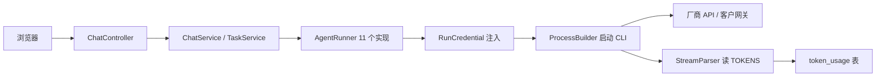
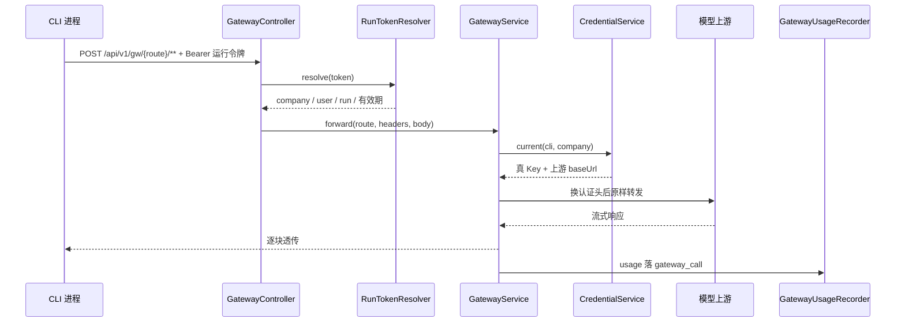

# SuperAgent 大模型网关：技术方案与阶段实施方案

> 一句话结论：**不新建 Agent，也不做协议转换**；在控制面内新增 `superagent-gateway`（L3），把 `RunCredential` 从「厂商真 Key + 厂商地址」切换成「单次运行令牌 + 网关地址」，用三个透传适配器覆盖 Anthropic Messages / OpenAI Chat Completions / OpenAI Responses，把换 Key、路由、计量、限速、多 Key 轮换收在一处。全链路以开关默认关闭、按公司灰度、秒级回滚的方式分 5 个阶段落地，每阶段有可执行命令和数字阈值。

| 项 | 值 |
| --- | --- |
| 版本 | v0.1（方案评审稿，未写代码） |
| 日期 | 2026-11-23 |
| 仓库 | `/Users/junsongyoung/mini_workspace/SuperAgent`，分支 `feat/employee-handover`，HEAD `938c214` |
| 上游 | https://github.com/oryx-labs/SuperAgent |
| 文体 | `tech-design`（`superagent-skills/src/main/java/com/superagent/skills/GenreSeeds.java:91-172`） |
| 交付模式 | 只出方案；代码在阶段实施时交付 |
| 范围 | G0–G4（控制面进程内网关）。G5（Worker/沙箱/独立部署）只定义接口，不在本轮实现 |

## 背景

三份项目文档把这件事定成了「目标架构里唯一还没建的模型入口」：`README.md:59-65` 把模型网关列为控制面的一部分并注明「正在建设中」；`website/zh/docs/roadmap.md:20-22` 写「所有模型调用都经过 SuperAgent 里的同一个入口，Key 不再交给 Agent，用量在一处统一计量，公司自己的模型网关也可以接在后面」；`docs/prd/superagent-architecture.html:697` 直接指定模块位置 `superagent-gateway · L3` 和职责「换 Key、路由、计量、限速、多 Key 轮换；先在控制面进程内，以后可以独立部署」。

本地工作笔记也两次点名这项缺口：`FEATURE-BACKLOG.md:33-39` 列为第 4 项，`HANDOVER-2026-11-18.md:91-97` 判定「体量：大；动 runtime 出站、凭证、用量、多 upstream」，并注明当前「Key 经 runner 环境/隔离 home 注入」。用户现在要求开工，本方案把它拆成能独立上线、能单独回滚的阶段。

现状量级（只读统计，`find . -name "*.java" -not -path "*/target/*" | wc -l`）：21 个 Maven 模块（`pom.xml:30-51`）、782 个 Java 文件、`AgentType` 11 个值（`superagent-core/src/main/java/com/superagent/core/chat/AgentType.java:8-26`）、构造 `RunCredential` 的调用点 6 处、**HTTP 反向代理/透传实现 0 处**。

## 目标和非目标

目标（写成「做到 X，用 Y 衡量」）：

1. 网关开关开启后，厂商真 Key 不出现在 CLI 进程的环境变量、argv、per-run 配置文件里；用单测断言 `environment()` 与各 runner 的配置写入内容，且开启前后 `token_usage` 记账不中断。
2. 对话、任务、SuperAgent、后台小活（文件打标、记忆整理、模型探测）的模型调用都经同一个入口；用 6 处调用点的注入矩阵覆盖，缺一处即不通过。
3. 三种协议透传保真：mock 上游返回含 tool_use / thinking / 缓存字段的固定 body，网关响应体与上游逐字节一致（`cmp` 无差异）。
4. 用量在网关统一计量：非流式 100% 覆盖，流式 ≥ 99%（100 次 mock 请求中至少 99 次产出 usage 行），并与现有 CLI 计量影子对账后再切主。
5. 按公司、按员工限速，多 Key 轮换与失败切换集中在网关，配额联动现有 `QuotaService`。
6. 客户自有模型网关是一等上游：模型列表、价格、请求头映射、员工到 Key 的映射可配置，不写死厂商。

非目标（本轮明确不做）：

- 不做 Agent 推理循环、不做提示词编排、不做模型自主决策（核心判断 02，`docs/prd/superagent-core-thesis.html:525-527`）。
- 不做协议转换（PRD 明确「用 CLI 去配合上游，以此避免协议转换」，`docs/prd/superagent-architecture.html:773`）。
- 不做独立部署、不引入 `superagent-protocol` / `superagent-cluster` / Worker / 出口代理（PRD `:693-701`、`:1225`）；这些属于第二步 b。
- 不做沙箱隔离，不改造工作区读写（`docs/prd/superagent-runtime-sandbox.html:336`）。
- 不回填历史用量数据（对齐 `docs/prd/token-usage-per-turn.md:3` 的「历史数据不处理」）。
- 不新增全局设置、不加 `@ConfigurationProperties`、不引入 WebFlux（受 `AGENTS.md:45-48`、`CLAUDE.md:106-109` 与现有 servlet 栈约束）。

## 现状

今天 SuperAgent 不构造任何模型 HTTP 请求。服务器 fork 厂商 CLI 子进程，CLI 自己直连上游；平台只负责把 endpoint + key 注入子进程，再从子进程 stdout 的 NDJSON 里换算用量。调用关系见图 1。


图 1　现状：真 Key 经 `RunCredential` 注入 CLI，CLI 直连上游，用量从 CLI 输出换算

关键接缝（每项都是本方案要改或要复用的地方）：

| 接缝 | 位置 | 现状 |
| --- | --- | --- |
| `RunCredential` | `superagent-core/src/main/java/com/superagent/core/chat/RunCredential.java:9` | `record(id, baseUrl, apiKey, bearer)`，`toString()` 脱敏（`:11-14`），`bearer` 注释已写明「relays and gateways expect」 |
| 唯一生产构造点 | `superagent-platform/src/main/java/com/superagent/platform/provider/CredentialService.java:226-229` | `toRun()` 解密真 Key、填厂商默认地址 |
| 6 处注入调用点 | `superagent-agent/src/main/java/com/superagent/agent/chat/ChatService.java:844`；`superagent-task/src/main/java/com/superagent/task/TaskService.java:1861`；`superagent-platform/src/main/java/com/superagent/platform/provider/ModelCall.java:82`；`superagent-orchestrator/src/main/java/com/superagent/orchestrator/SuperAgentService.java:420`；`superagent-agent/src/main/java/com/superagent/agent/files/FileTagger.java:260`；`superagent-agent/src/main/java/com/superagent/agent/memory/AgentMemoryService.java:507` | 都是 `credentials.current(cli)` → `new AgentRunRequest(..., credential)` |
| runner 注入 | `superagent-runtime/src/main/java/com/superagent/runtime/cli/JsonLineCliRunner.java:78,136`；`ClaudeCliAgentRunner.java:142-154,432-455`；`CodexCliAgentRunner.java:114-117,190-200` | 环境变量 / `-c` / per-run 临时配置 / 隔离 home，共 11 家 |
| 失败切换 | `CredentialService.java:171-185`；`superagent-platform/src/main/java/com/superagent/platform/provider/EndpointFailures.java:15-59` | 按错误文本分类，整轮重跑（`ChatService.java:867-876`） |
| 单次运行令牌 | `superagent-runtime/src/main/java/com/superagent/runtime/mcp/McpGrants.java:35-49,268-283` | 24 字节随机 hex，进程内 `ConcurrentHashMap`，无 TTL/签名，`close()` 时撤销；注释 `:46` 写明前提是「run is spawned by this process」 |
| `/mcp` 鉴权 | `superagent-web/src/main/java/com/superagent/web/mcp/McpController.java:54-77` | `Authorization: Bearer` + `grants.find()` + `TenantContext.call(companyOf(grant), …)` |
| 用量 | `superagent-core/src/main/java/com/superagent/core/usage/UsageRecorder.java:25-40`；`superagent-cost/src/main/java/com/superagent/cost/usage/TokenUsageService.java:84-128`；`superagent-storage/src/main/java/com/superagent/storage/jdbc/JdbcUsageStore.java:17-75` | `TOKENS` 事件 → 计价 → `token_usage` 表 |
| 安全链 | `superagent-web/src/main/java/com/superagent/web/auth/SecurityConfig.java:59-83` | `/mcp` 单独 `permitAll` 后由令牌鉴权；`anyRequest().authenticated()` 兜底 |
| 分层守护 | `superagent-storage/src/test/java/com/superagent/storage/jdbc/TenantScopeGuardTest.java:16-50` | 静态扫描 DDL，断言每张表有 `company_id` 且 Store 读 `TenantContext.require()` |

现状里四个必须解决的问题：

1. **Key 在 CLI 环境里**：`HANDOVER-2026-11-18.md:95` 与 PRD `docs/prd/superagent-architecture.html:1201` 都写明「写进 CLI 的环境变量或运行配置文件，Agent 读得到」。同公司其他 Agent 可读同公司 Key，只是被接受为现状；目标态是「只在模型网关」。
2. **用量靠 CLI 输出换算，口径脆弱**：`docs/prd/token-usage-per-turn.md:19-50` 实测 `--resume` 的 `modelUsage` 是会话累计值，`ClaudeUsageLedger` 要做差值；`KimiCliAgentRunner` 得从 `wire.jsonl` 增量读。网关统一计量是 PRD `:1203` 的目标。
3. **没有协议层**：`ProviderCatalog.Access.protocol`（`superagent-core/src/main/java/com/superagent/core/provider/ProviderCatalog.java:21-27`）只是元数据，全库只有 `ProviderInferenceProbe.java:456` 读它选探测路径；运行时对话链路不感知协议。
4. **令牌不能跨进程**：`McpGrants` 是内存 Map。当前同机成立，Worker 分离后不成立——这决定了本方案要先把令牌解析抽象成接口，而不是把 Map 直接搬进网关。

## 方案

### 先回答「真的需要 Agent 吗」

不需要。网关的分支可以穷举：协议三种、上游由公司配置决定、失败由状态码和 `EndpointFailures` 分类决定、令牌校验是查表/验签。它是 **Routing + 固定 Pipeline**，不是 Agent。硬加 LLM 决策会引入不确定性、额外成本，还直接违背核心判断 02「SuperAgent 不做执行框架、不做推理循环」（`docs/prd/superagent-core-thesis.html:525-527`）。因此本方案不引入任何自主循环，也不需要 `max_steps` / token 预算这类 Agent 护栏；取而代之的是请求级超时、并发上限、字节上限和成本熔断。

### 架构

一次请求的处理链见图 2。核心手法是：**CLI 侧零改动**——网关开关只改变 `RunCredential` 的两个字段值，11 个 runner 拿到的仍是 `baseUrl + apiKey + bearer`，不知道对面是厂商还是自家网关。图 2 的静态版见 `images/model-gateway-architecture.svg`，含逐步标注，可单独打开。


图 2　目标链路：CLI 只持令牌，换 Key 与计量都在控制面

### 组件表

「新增」= 当前仓库不存在；「复用」= 已存在、按现状类名引用。

| 组件（模块 / 层） | 职责 | 输入 | 输出 | 失败处理 |
| --- | --- | --- | --- | --- |
| `RunTokenResolver` + `RunToken`（新增，`superagent-core` L0） | 解析单次运行令牌，返回公司/员工/运行/有效期 | Bearer 令牌 | `RunToken` 或空 | 空 → `ForbiddenException`（401）；过期 → 401 |
| `McpGrants` 实现该接口（复用，`superagent-runtime` L1） | G1–G4 的同机实现；`Grant` 增加 `expiresAt`，`find()` 拒绝过期 | 现有 `Grant` | `RunToken` | 令牌撤销后 `find()` 返回空 |
| `GatewayProperties` / 开关（新增，`superagent-gateway` L3） | `superagent.gateway.*` 的 `@Value` 读取，默认全关 | 配置 | 开关、超时、上限 | 配置非法 → 启动失败（`IllegalArgumentException`） |
| `GatewayRouteRegistry`（新增，`superagent-gateway` L3） | 按公司 + CLI + 模型名选上游条目（厂商 API / 客户自有网关） | 公司、模型名、协议 | 上游 baseUrl + Key 池条目 id | 无可用条目 → `NoCompanyKeyException`（复用 `CredentialService.java:205`） |
| `GatewayService`（新增，`superagent-gateway` L3） | 编排：验令牌 → 选路 → 换头 → 转发 → 计量 | `HttpServletRequest` | 流式 `StreamingResponseBody` | 见「错误处理矩阵」 |
| `AnthropicMessagesAdapter` / `OpenAiChatAdapter` / `OpenAiResponsesAdapter`（新增，同上） | 三种协议的 header 白名单与 usage 抽取；**不改 body** | 上游响应字节流 | 透传字节 + usage | 抽不到 usage → 降级标 `usage_source=cli` + warn + 指标 |
| `GatewayUsageRecorder`（新增，同上） | 写 `gateway_call`，并与 `token_usage` 影子对账 | usage + 上下文 | `UsageRecord`（复用 core） | 写库失败 → 异步重试队列，绝不阻塞响应 |
| `GatewayRateLimiter`（新增，同上） | 按公司 / 员工两级令牌桶 | `RunToken` | 放行或 429 | 超限 → 429 + `Retry-After` |
| `GatewayController`（新增，`superagent-web` L5） | 薄 HTTP 层：映射路径、取 header、回写状态码与流 | HTTP | HTTP | 流式错误由 terminal error event 收口（`CLAUDE.md:110`） |
| `CredentialService`（复用，`superagent-platform` L2） | 开关开启时产出「网关地址 + 运行令牌」形式的 `RunCredential`；关闭时保持现状 | cli、公司、运行上下文 | `RunCredential` | 无公司 Key → 现有 `NoCompanyKeyException` |
| `ModelRouter`（复用，`superagent-core` L0，实现在 `superagent-cost` L3） | 路由策略（`cheapest()` / `chatModels()` / `reportFailure()`） | 模型可用性 | `ModelChoice` | 空 → 回退默认模型（`ModelRouter.java:13-20`） |
| `UsageRecorder` / `UsageStore`（复用，L0 / L1） | 现有记账底座 | `TOKENS` 事件 | `token_usage` 行 | 不变 |

### 分层与依赖（本方案最容易踩的一条）

PRD `:697` 指定 `superagent-gateway` 在 **L3，依赖 platform、core（ModelRouter）**。`AGENTS.md:27-43` 和 `CLAUDE.md:47-50,73-74,102-103` 规定只向下依赖、同层兄弟不互依。这里有一个必须处理的冲突：

- `ModelRouter` 接口在 `superagent-core`（L0），实现 `TaskModelRouter` 在 `superagent-cost`（**L3，同层**）。
- `TokenUsageService`（计价）也在 `superagent-cost`（L3）。

因此 `superagent-gateway` 的 pom **只声明** `superagent-platform`、`superagent-core`、`superagent-api`；运行时由 `SuperAgentServerApplication.java:13-14` 的 `@ComponentScan("com.superagent")` 把 `superagent-cost` 的实现按接口注入。计价若必须进网关链路，就把计价能力抽成 `superagent-core` 的新接口 `UsagePricer`（新增），由 `TokenUsageService` 实现——这是**往下实现、不往上依赖**。G3 之前不抽：网关只记 token 与 `usage_source`，金额沿用现有链路，避免同层耦合。

新增模块要改 4 个 pom：`pom.xml:30-51` 加 `<module>superagent-gateway</module>`、`pom.xml:60-170` 加 dependencyManagement 条目、`superagent-server/pom.xml:19-76` 加依赖（否则 `@ComponentScan` 扫不到、release tarball 不含）、`superagent-web/pom.xml:19-48` 加依赖（controller 在 web）。项目无 maven-enforcer，分层靠 Maven 依赖可见性 + 评审，因此这条要写进 PR 检查单。

### 数据模型

新增一张只增不改的表 `gateway_call`（DDL 内联 Java，走 `TenantSchema.create()`，见 `superagent-storage/src/main/java/com/superagent/storage/jdbc/TenantSchema.java:29-36`；**不要复用任何旧表名**，该工具类发现无 `company_id` 的旧表会直接 DROP）。

| 字段 | 类型 | 说明 |
| --- | --- | --- |
| `company_id` | VARCHAR(64) | 主键一部分，`TenantSchema.company()` 取值，fail-closed |
| `id` | VARCHAR(64) | 请求 id = `traceId`（复用 `TraceIdFilter.java:29-42`） |
| `run_id`, `user_id`, `task_id` | VARCHAR(64) NULL | 绑定到运行与人 |
| `protocol` | VARCHAR(16) | `anthropic` / `chat_completions` / `responses` |
| `route`, `model`, `upstream_id` | VARCHAR(128) | 选路结果；不含 Key |
| `input_tokens`, `output_tokens`, `cache_read_tokens`, `cache_write_tokens` | BIGINT | 与 `TokenUsage.java:15-26` 同口径 |
| `usage_source` | VARCHAR(8) | `gateway` / `cli`（降级标记） |
| `status`, `error_type` | VARCHAR(32) | 成功 / 上游状态 / 超时 / 限流 / 令牌拒绝 |
| `first_byte_ms`, `latency_ms`, `bytes_out` | BIGINT | 延迟与流量 |
| `created_at` | DATETIME | 索引 `(company_id, created_at)`、`(company_id, run_id)` |

不新增公司设置表：限速阈值与开关沿用 `Company` 记录 + 现有公司设置读写路径（`CLAUDE.md:106-109`「don't add a new global setting」）；平台级只加部署值（见「配置、灰度与回滚」），性质等同已有的「内置 MCP 地址」。

### 接口

路径常量加到 `superagent-api/src/main/java/com/superagent/api/ApiPaths.java`（`GATEWAY = V1 + "/gw"`），沿用该文件 `:6-8` 的「破坏性变更引入新版本常量」约定。

| 路由前缀 | 覆盖 CLI | 上游路径处理 |
| --- | --- | --- |
| `/api/v1/gw/anthropic/**` | Claude Code、GLM、DeepSeek（Anthropic 兼容） | 去掉前缀后原样拼到上游 base |
| `/api/v1/gw/chat/**` | Qwen、Kimi、Grok（OpenAI 兼容）、CodeBuddy、MiniMax、Gemini、Qoder | 同上 |
| `/api/v1/gw/responses/**` | Codex | 同上 |

`SecurityConfig.java:59-83` 必须显式加 `.requestMatchers(ApiPaths.GATEWAY + "/**").permitAll()`，鉴权完全由 `GatewayController` 内的 Bearer 令牌完成，方式与 `McpController.java:57-62` 一致，并同样用 `TenantContext.call(token.companyId(), …)` 切公司上下文。否则沙箱只有令牌、没有 session cookie，会被 `anyRequest().authenticated()` 拦成 401。

请求头处理：

- 删除客户端带来的 `Authorization` / `x-api-key` / `api-key` 及任何 Key 痕迹，再由网关按上游条目的 `bearer` 语义加回（复用 `superagent-platform/src/main/java/com/superagent/platform/provider/ApiAccess.java:52-59` 的 `authorize` 规则）。
- 白名单透传：`content-type`、`accept`、`anthropic-version`、`anthropic-beta`、`x-request-id` 系列等；**默认拒绝其他自定义头**，避免把运行令牌泄漏给上游。
- 客户自有网关：按公司配置注入员工/任务标识头与员工→Key 映射（PRD `:774`）。头名由公司配置决定，不写死。
- 增加 `X-Superagent-Request-Id: <traceId>`，供客户网关对账；该值同时是 `gateway_call.id`。

响应：原样转发状态码、content-type 与响应体；上游 401/429/5xx 不得被 `GlobalExceptionHandler` 统一改写成 500（`superagent-web/src/main/java/com/superagent/web/GlobalExceptionHandler.java:100-106`）。流式场景按 `CLAUDE.md:110` 的约定，由流的 terminal error 事件作为统一收口点。

### 一次请求的固定流程（竖切片）

1. `GatewayController` 收请求，取 Bearer → `RunTokenResolver.resolve()` → 失败返回 401。
2. `TenantContext.call(token.companyId(), …)` 建立公司上下文；`TraceIdFilter` 已有 `X-Request-Id`（`superagent-web/src/main/java/com/superagent/web/TraceIdFilter.java:29-46`）。
3. `GatewayRateLimiter` 按公司 + 员工检查；超限 429。
4. `GatewayRouteRegistry` 按协议 + 模型名选上游条目；`CredentialService` 解密真 Key。
5. `GatewayService` 用 JDK `java.net.http.HttpClient`（项目现有唯一 HTTP 客户端风格，见 `ProviderInferenceProbe.java:50`）带显式 `connectTimeout` + `HttpRequest.timeout` 发起 `sendAsync`，`BodyHandlers.ofInputStream()` 逐块 pump 到 `StreamingResponseBody`。**不缓冲整个响应**，否则破坏 SSE 与首字节延迟。
6. 旁路从流里读 usage（只读，不改写字节），交给 `GatewayUsageRecorder` 写 `gateway_call`。
7. 关闭时撤销/放行运行令牌由原 `McpGrants.close()` 在 `finally` 完成（`ChatService.java:877-881`、`TaskService.java:1893-1897`），网关不重复管理生命周期。

### 错误处理矩阵

模型 `POST` 请求**非幂等**，重试会造成重复计费。因此这里的「重试」只限于请求尚未到达上游的连接前失败，其余交给现有整轮 failover（`ChatService.java:867-876`、`TaskService.java:1880-1891`）。

| 场景 | 分类 | 处理 | 降级 | 告警 |
| --- | --- | --- | --- | --- |
| 令牌缺失/过期/越公司 | 终止 | 401 + 审计 | 无 | 是 |
| 限流命中 | 终止 | 429 + `Retry-After` | 无 | 否（限流内） |
| 上游连接超时 / 拒绝（未发出） | 可重试 | 换 Key 重试 **1 次**，指数退避 + 抖动，初始 1 s、上限 10 s | 全池失败 → 透传错误给 CLI，走整轮 failover | 是 |
| 上游 429 / 5xx（已发出） | 可重试但**不重试** | 状态原样透传；标 `error_type` | 由 `EndpointFailures` 分类触发换 Key / 换模型 | 是 |
| 上游 401/403 | 需人工 | 透传 + 标记该 Key 失败（复用 `CredentialService.failover`） | 切下一 Key | 是 |
| 流式 usage 抽不到 | 可降级 | 记 `usage_source=cli`，沿用 CLI 计量 | 覆盖率为 0 时告警 | 是 |
| 写 `gateway_call` 失败 | 可重试 | 异步队列重试 2 次，不阻塞响应 | 丢弃并打 `lost_usage` 指标 | 是 |
| 网关自身异常 / 超时 | 可降级 | 开关级回滚到直连 | 秒级切 `enabled=false` | 是 |

显式超时（配置值，G0 用基线校准）：连接 5 s、首字节 30 s、整个流 600 s、单请求体上限 50 MB（对齐 `application.yml:9-13` 的 multipart 上限）、并发上限按 `superagent.gateway.max-concurrency` 有界。所有降级必须打 warn 日志 + 指标 +1，禁止静默。

### 可观测与脱敏

- traceId：复用 `TraceIdFilter` → `LogContext.setTraceId()`（`superagent-core/src/main/java/com/superagent/core/logging/LogContext.java:15-36`）→ `LogFormat.java:16-18` 自动出现在每行日志；同时作为 `gateway_call.id` 和透传给上游的 `X-Superagent-Request-Id`。
- 指标：在 `MetricNames.java:14-20`（目前只有前缀和 `application` tag）新增 `superagent.gateway.*` 常量，用项目已有的 Micrometer + Prometheus（`superagent-server/pom.xml:66-69`、`application.yml:24-31`）：请求数、成功率、首字节 P95、总延迟 P95、上游错误率、按协议分布、计量覆盖率、降级次数、限流次数。
- 脱敏：Key、运行令牌、完整请求/响应 body 一律不进日志；只记模型名、字节数、路由 id、状态、耗时。`RunCredential.toString()`（`:11-14`）已脱敏，网关沿用；新增的 `RunToken` 同样覆写 `toString()`。日志中公司/员工只记 id，不记姓名邮箱。

### 配置、灰度与回滚

遵循 `application.yml` 的 `superagent.<域>.<项>` + `${SUPERAGENT_XXX:default}`、`@Value` 注入（全项目无 `@ConfigurationProperties`），并沿用 `superagent.provider.cli-config.enabled:false` 这类默认关闭的开关模式：

```
superagent.gateway.enabled=${SUPERAGENT_GATEWAY_ENABLED:false}
superagent.gateway.self-url=${SUPERAGENT_GATEWAY_SELF_URL:}
superagent.gateway.connect-timeout-seconds=${SUPERAGENT_GATEWAY_CONNECT_TIMEOUT:5}
superagent.gateway.first-byte-timeout-seconds=${SUPERAGENT_GATEWAY_FIRST_BYTE_TIMEOUT:30}
superagent.gateway.request-timeout-seconds=${SUPERAGENT_GATEWAY_REQUEST_TIMEOUT:600}
superagent.gateway.max-concurrency=${SUPERAGENT_GATEWAY_MAX_CONCURRENCY:64}
superagent.gateway.max-body-bytes=${SUPERAGENT_GATEWAY_MAX_BODY:52428800}
```

`self-url` 是平台级部署值（等同已有的 `superagent.mcp.self-url`，`McpGrants.java:178`），不是公司设置；公司维度的限速阈值、上游头映射存公司设置，不新增全局设置。

灰度按公司维度，四步：影子（网关只记不返回，0% 流量）→ 公司内部账号 100% → 单公司全量 → 逐公司放量。每步观察成功率、首字节 P95、计量覆盖率、成本。**回滚第一步永远是切开关**：`enabled=false` 后 `CredentialService` 恢复产出真 Key + 厂商地址，秒级回到现状，`gateway_call` 只增不改、不必清理。触发条件：任务成功率较基线下降 ≥ 5 个百分点、首字节 P95 超基线 50 ms 且持续 10 分钟、计量覆盖率 < 99%、出现任意跨公司访问或 Key 泄漏。

## 备选方案

| 备选 | 做法 | 真正的优点 | 放弃依据 |
| --- | --- | --- | --- |
| A. 独立网关进程（LiteLLM / Higress / 自研 Go） | 控制面前挂一个独立服务，公司配置经 API 同步 | 协议兼容现成、可独立扩缩容、不占 JVM 线程、故障域隔离 | PRD `:697` 明确「先在控制面进程内，以后可以独立部署」；与公司设置、Key 池、多租户、计量深度耦合，独立进程要再实现一遍租户上下文与审计；`README.md:59` 要求 SaaS 与私有化同一套代码，多一个进程就多一种部署形态 |
| B. 纯反向代理（Nginx / Envoy 换 header） | 只替换认证头，不解析响应 | 改动最小、性能最好、零 Java 代码 | 拿不到流式响应里的 usage，做不到 PRD `:775`「token 用量在这里统一计量」；也无法按公司/员工限速、给客户网关传员工标识头 |
| C. 网关端点单独引入 Spring WebFlux | 响应式转发，背压与非阻塞 IO | 长连接不占 servlet 线程，天然适合流式 | 全项目只有 `spring-boot-starter-web`（`superagent-web/pom.xml:50-53`），无 webflux 依赖；引入两套并发模型与线程池。**保留为 G4 压测不达标时的升级路径** |
| D. 统一转成 OpenAI 协议 | 网关做三种协议互转 | 上游只需对接一种 | PRD `:773` 明确「用 CLI 去配合上游，以此避免协议转换」；转换会丢工具调用、思考过程、提示缓存语义，且「优先用成熟的开源组件，不自己写」 |

## 迁移和兼容

- **存量运行零改动**：`RunCredential` 的 record 形状不变，11 个 runner 的 `environment()` / `buildCommand()` / 临时配置文件全部不改；只变值的来源。这是本方案控制改动面的关键。
- **升级后行为不变**：开关默认 `false`，走原来的 `CredentialService.toRun()`（`CredentialService.java:226-229`）。
- **旧数据**：不回填 `token_usage`；`gateway_call` 从上线时刻起新增。对齐 `docs/prd/token-usage-per-turn.md:3`。
- **DDL**：内联 Java + `TenantSchema.create()`；新表从零建，不会触发 `TenantSchema.java:29-36` 的 DROP 分支。新增列如需演进，用 `MysqlAgentStore.java:46-52` 的 `ensureColumn` 方式。
- **计费双轨**：G3 起 `gateway_call` 与 `token_usage` 并行写、只对账不切换；G4 通过开关把主账切到网关，CLI 计量保留为 fallback。切主前必须完成差异分布基线。
- **回滚**：各阶段可分别 revert；开关是最后一道、也是最快的回滚手段。
- **协议字段**：三种上游的流式 usage 事件名与字段名，G0 探针前一律标 `[待核实]`，不写进代码常量。

## 阶段实施方案

每阶段都能单独上线、单独回滚；「退出条件」不满足不得进入下一阶段。项目演进路线把网关放在「第二步 b 或紧随其后」（`docs/prd/superagent-architecture.html:1225`），本方案 G1–G4 在**当前单机形态**内即可完成，不依赖 Worker/沙箱；G5 才依赖第二步 b。

| 阶段 | 目标 | 主要改动（文件/模块） | 产出 | 退出条件（DoD） |
| --- | --- | --- | --- | --- |
| **G0 探针与契约** | 把三种协议的真实请求形状、CLI 拼路径规则、流式 usage 字段量清楚 | 只读：JDK `HttpServer` mock 上游（复用 `superagent-runtime/src/test/java/com/superagent/runtime/mcp/McpClientTest.java:56-95` 的写法）；录制样本放 `superagent-gateway/src/test/resources/gateway/` | 证据日志（协议 × CLI 的路径矩阵、usage 字段映射表、基线延迟数字） | 三类协议各有 ≥1 份录制样本；11 个 CLI 的 baseUrl→实际请求路径逐条有据；所有未实测字段标 `[待核实]` |
| **G1 竖切片** | 单协议（Anthropic Messages）跑通「令牌 → 换 Key → 透传 → 计量」 | 新建 `superagent-gateway` + 4 个 pom 注册；`RunTokenResolver`（core，新增）+ `McpGrants` 实现；`GatewayController`（web，新增）；`ApiPaths.GATEWAY`；`SecurityConfig` 放行；`GatewayProperties` 开关 | 可运行的 `scripts/run-local.sh` 实例 + 一条端到端链路 | 验收 1–4、11 通过（见下）；开关关闭时全量 `mvn clean install` 与基线一致 |
| **G2 三协议与选路** | 三适配器 + 客户自有网关作为一等上游 + 注入矩阵全覆盖 | 三个 Adapter；`GatewayRouteRegistry`；`CredentialService` 开关分支；6 处调用点传入运行上下文；按公司的请求头/员工→Key 映射配置 | 11 个 runner 注入矩阵、跨公司 Key 隔离测试 | 验收 2、3、5、6、12 通过；真 Key 不出现在 CLI 环境/argv/配置文件 |
| **G3 计量与可观测** | 影子计量、对账、trace、指标、脱敏日志 | `gateway_call` 表 + `GatewayUsageRecorder`；流式 usage 抽取；`MetricNames` 常量；脱敏日志；对账报告脚本 | 基线报告 `baseline.json`、Prometheus 指标清单、一条样例 trace | 验收 7、8、9 通过；计量覆盖率与对账差异达到量化通过线 |
| **G4 治理与切换** | 限流、配额联动、灰度、回滚演练、评测集进 CI | `GatewayRateLimiter`；`QuotaService` 联动；按公司灰度开关；≥20 条评测集 + CI 门禁；回滚演练 | 压测报告、评测基线、回滚 runbook | 验收 10 及全部量化通过线达标；对抗用例 100% 通过；回滚演练成功 |
| **G5（不在本轮）** | 签名令牌可跨进程、网关可独立部署、与 Worker/沙箱联动 | 新增 `SignedRunTokenResolver` 替换同机实现；依赖 `superagent-protocol` / `superagent-cluster` | — | 依赖第二步 b 完成；本轮只保证 `RunTokenResolver` 接口无需改动即可替换 |

## 测试和验收

### 验收标准

1. 开关 `enabled=false`（默认）时，`mvn -B -ntp clean install` 全绿，现有 133 个测试文件行为不变，无新增失败。
2. 开关开启后，`CredentialService.current()` 返回的 `RunCredential.baseUrl` 指向 `superagent.gateway.self-url`，`apiKey` 等于当次运行令牌，`bearer=true`；6 处调用点全部命中，缺一即失败。
3. 11 个 `AgentRunner` 实现中，环境/argv/临时配置文件里不含任何厂商真 Key；用单测断言 `environment()` 与配置内容，另用一次本地进程环境抽查佐证。
4. 单协议竖切片：mock 上游返回固定 body，网关响应体 `cmp` 逐字节一致，状态码与 `content-type` 一致，未出现白名单外新增请求头。
5. 三种协议各跑通一次完整请求（含流式 `text/event-stream`），工具调用 / thinking / 缓存相关字段原样保留。
6. 客户自有网关：自定义上游地址、自定义头映射、员工→Key 映射各至少 1 例生效；公司 A 的 Key 绝不出现在公司 B 的请求中。
7. 每次请求产出一行 `gateway_call`，含 `company_id`、`run_id`、`traceId`、模型、四类 token、`usage_source`；`TenantScopeGuardTest` 通过。
8. 影子对账：同一批运行内 `gateway_call` 与 `token_usage` 的 token 差异分布记录成 `baseline.json`，G4 前不得切主账。
9. 日志与响应中 grep 不到真 Key、运行令牌、完整 body；`X-Request-Id` 能串起网关日志、`gateway_call.id`、上游收到的 `X-Superagent-Request-Id`。
10. 限流：配置 10 req/s 后并发压 100 次，成功数 ≤ 11、其余 429 且带 `Retry-After`；降级事件有 warn 日志与指标。
11. 回滚：开关切回 `false` 后 30 秒内新发起的运行全部恢复直连，无失败任务、无残留令牌请求。
12. 评测集 ≥ 20 条全部进 CI，L1 断言与对抗用例 100% 通过；任一安全用例失败即阻断发布。

### 验证命令

```bash
mvn -B -ntp clean install
mvn -pl superagent-gateway,superagent-web,superagent-platform -am test
mvn -pl superagent-storage -am test -Dtest=TenantScopeGuardTest
mvn -pl superagent-gateway -am test -Dtest=GatewayContractEvalTest
scripts/run-local.sh --server.port=18099
curl -sS -o /tmp/gw-body -D /tmp/gw-head -X POST http://127.0.0.1:18099/api/v1/gw/anthropic/v1/messages -H 'Authorization: Bearer <run-token>' -H 'Content-Type: application/json' --data-binary @superagent-gateway/src/test/resources/gateway/anthropic-request.json
cmp /tmp/gw-body superagent-gateway/src/test/resources/gateway/anthropic-expected.json
curl -sS http://127.0.0.1:18099/actuator/prometheus | grep '^superagent_gateway_'
grep -R -n -E 'sk-ant-|sk-proj-|Bearer [0-9a-f]{48}' logs/ && exit 1 || true
```

命令说明：第 4 行 `GatewayContractEvalTest` 是 G4 要新增的评测驱动类；第 5 行用 `scripts/run-local.sh` 起第二实例（`:18099`），符合 `CLAUDE.md:32` 的用法；第 6–7 行的 `<run-token>` 由本地测试签发，不接触真实厂商。全部验收使用 JDK `HttpServer` mock 上游，**不花真 API 额度**；真机冒烟必须由用户另行授权（`HANDOVER-2026-11-18.md:128`）。按 `AGENTS.md:5` / `CLAUDE.md:5`，以上只在本地执行：不 `git push`、不 `scp`/`ssh`、不跑 `scripts/package.sh`、不部署。

### 量化通过线

阈值分两类：可直接判定的写死；与性能/口径相关的先在 G0/G3 量基线，再按「基线 + 容差」判定，不允许拍脑袋。

| 指标 | 通过线 | 量法 |
| --- | --- | --- |
| 全量构建 | 退出码 0，新增失败 0 | `mvn -B -ntp clean install` |
| 透传保真 | 字节差异 0 | `cmp` |
| 真 Key 泄漏 | 0 处 | 单测 + `grep` 日志/环境 |
| 跨公司访问 | 0 处 | 对抗用例 + 存储层守护测试 |
| 计量覆盖率 | 非流式 100%、流式 ≥ 99%（100 次） | `gateway_call` 行数 / 请求数 |
| 用量对账 | 差异中位数 ≤ 2%、P95 ≤ 10%（G3 基线校准后锁定） | `baseline.json` 逐条 diff |
| 网关额外首字节延迟 | ≤ 基线 + 50 ms 且绝对值 ≤ 100 ms（G0 基线） | mock 上游 100 次 P95 |
| 限流精度 | 10 req/s 下 100 并发成功 ≤ 11 | 压测计数 |
| 任务成功率 | 较灰度前基线下降 < 5 个百分点 | 现有 Analytics 口径 |
| 回滚耗时 | ≤ 30 s | 开关切换后采样新运行 |
| 对抗用例 | 100% 拦截 | CI 门禁 |

### 评测集（≥ 20 条，进 CI）

按 50% 正常 / 30% 边界 / 20% 对抗分布，文件 `superagent-gateway/src/test/resources/gateway/eval_cases.jsonl`，驱动类 `GatewayContractEvalTest`（新增）。

| ID | 类别 | 输入 | 期望 |
| --- | --- | --- | --- |
| N01–N03 | normal | 三协议各一次非流式请求 | 200、body 一致、`gateway_call` 1 行 |
| N04–N06 | normal | 三协议各一次流式请求 | 逐块透传、usage 记到、流正常终止 |
| N07 | normal | 含 tool_use / tool_result 的 Anthropic 响应 | 原样保留，工具调用不丢 |
| N08 | normal | 含 thinking / 缓存字段的响应 | 原样保留 |
| N09 | normal | 客户自有网关 + 自定义头映射 | 标识头到达上游、真 Key 来自该公司的池 |
| N10 | normal | 公司 A 与公司 B 各发一次 | 各自 Key、各自 `company_id`，不交叉 |
| B01 | boundary | 空 body / 缺模型名 | 400，不转发、不计量为成功 |
| B02 | boundary | 超长 body（> `max-body-bytes`） | 413，快速失败，不占上游连接 |
| B03 | boundary | 上游 30 s 不吐首字节 | 超时终止、错误透传、有降级指标 |
| B04 | boundary | 上游中途断流 | 流正常关闭、`usage_source=cli` 降级 + warn |
| B05 | boundary | 上游返回无 usage 字段的流 | 覆盖率不虚报，降级标记正确 |
| B06 | boundary | 上游 429 / 5xx / 401 各一 | 状态原样透传，401 标 Key 失败并切下一 Key |
| A01 | adversarial | 无令牌 / 伪造令牌 | 401，无任何上游调用 |
| A02 | adversarial | 公司 A 的令牌请求公司 B 的模型 | 403/401，`company_id` 强制取令牌绑定值 |
| A03 | adversarial | 已 `close()` 的运行令牌复用 | 401 |
| A04 | adversarial | 请求头里塞真 Key 试图覆盖上游 Key | 被剥除，上游只收到网关选出的 Key |
| A05 | adversarial | 响应/日志中诱导回显令牌 | 0 处泄漏 |

L1 确定性断言做门禁（100% 通过），对抗用例零容忍；不引入 LLM-as-Judge——网关是确定性系统，语义评分没有意义。

## 约束遵循对照

| 约束出处 | 内容 | 本方案如何遵守 |
| --- | --- | --- |
| `docs/prd/superagent-core-thesis.html:517-561` / `README.md:27-34`（六个核心判断，即项目「宪法」） | 02 不重造 Agent；04 厂商中立；05 凭证公司统一保管、每件事有记录 | C3 判定为固定 Pipeline；客户网关一等上游、不做协议转换；Key 只在网关、`gateway_call` 全量审计 |
| `docs/prd/superagent-architecture.html:697,768-775,789-800` | `superagent-gateway` L3、控制面进程内、三协议透传、单次运行令牌、按公司/员工限速 | 模块位置、依赖、职责、令牌语义逐条对齐 |
| `AGENTS.md:5-7` / `CLAUDE.md:5-7` | 绝不 push / scp / ssh / 部署 / 跑 `scripts/package.sh` | 验收命令全为本地 `mvn` / `scripts/run-local.sh` / `curl 127.0.0.1` |
| `AGENTS.md:25-43` / `CLAUDE.md:47-50,73-74,102-103` | 分层单向、新模块注册父 pom、包 `com.superagent.*`、controller 在 web、业务在 domain | 4 个 pom 改动清单；gateway 只声明 platform/core/api；`ModelRouter` 用接口注入避免同层依赖 |
| `AGENTS.md:45-48` / `CLAUDE.md:106-109` | 新表带 `company_id`、`TenantContext.require()` fail-closed、后台线程用 `run/wrap`、不新增全局设置 | `gateway_call` 主键含 `company_id`；限速阈值存公司设置，平台级只有部署值 |
| `CLAUDE.md:80-82,110` | 异常继承 `core.error` 基类、异常上抛、统一 handler | 令牌/选路异常用 `ForbiddenException`/`NotFoundException`；流式错误按 terminal error 收口；不 catch-and-log |
| `CLAUDE.md:104-105` | 测试收敛、注释稀疏 | 评测集以行为为单位，不为每种参数排列写一条；代码只注释非显然的 why |
| `.cursor/rules/ironbee-devtools-use.mdc:21-29` | 改动要在真实运行系统上验证 | G1 起用 `scripts/run-local.sh` + `curl` 做端到端验证；纯文档/配置改动才跳过 |
| `superagent-skills/.../GenreSeeds.java:91-172`（tech-design 文体包） | 必备小节、`path:行号` 引用、Mermaid 图编号且正文引用、备选 ≥2、量化验收、待定问题 ≤5 | 本文档章节、图 1/图 2、`## 验证命令`、备选 A–D、待定 5 条 |
| `CodingPrompts.java:35,53` / `general-task-harness.md:7` | 验收标准写成可逐条核对的编号清单 + 验证命令 | 「验收标准」12 条 + 「验证命令」代码块 |
| `HANDOVER-2026-11-18.md:126-131` | 不误提交未跟踪文件、付费真 API 需授权、用户没说就先改本地 | 只新增本地文件、不 commit/push；评测全用 mock 上游 |

仓库内**没有名为「宪法」的文件**；用户所指按 `README.md:27-34`「What we believe」与 `docs/prd/superagent-core-thesis.html:511-563`「六个核心判断」理解，已在上表逐条落实。

## 风险和应对

| 风险 | 概率 / 影响 | 触发条件 | 应对 |
| --- | --- | --- | --- |
| 流式 usage 抽取不全 | 高 / 高 | 厂商事件名差异、CLI 版本升级、客户网关不返回 usage | G0 录制三协议真实响应；抽不到即 `usage_source=cli` 降级 + 指标，绝不静默丢；覆盖率 < 99% 阻断放量 |
| servlet 线程被长流占满 | 中 / 高 | 并发长任务、上游慢 | 有界并发 + 首字节/总超时 + 请求体上限；G4 压测不达标启用备选 C |
| 令牌机制跨进程失效 | 中 / 中 | 第二步 b 之后 Worker 与沙箱分离 | `RunTokenResolver` 接口先行，G5 换签名令牌实现，网关代码不动 |
| 网关成为单点 | 中 / 高 | 网关自身异常、OOM | 开关秒级回滚到直连；多实例 HA 属 PRD 第四步，不在本轮承诺 |
| 11 家 CLI 的 baseUrl 拼接差异 | 高 / 中 | 各家 CLI 对 baseUrl 尾部路径处理不同（已有先例：`GrokAcpAgentRunner.java:145-165` 按 base 形状选变量） | G0 逐家探针出路径矩阵；G2 注入矩阵逐家覆盖，不达标不进 G3 |
| 客户自有网关的头/模型名约定各异 | 中 / 中 | 客户按人发 Key、自定义统计头 | 全部配置化，不写死；模型别名表沿用 `ProviderService.cliFor()`（`:164-180`） |
| 非幂等 POST 被误重试导致重复计费 | 低 / 高 | 把 5xx 当成可重试 | 错误矩阵明确「已发出不重试」，只由现有整轮 failover 处理 |
| 真 API 额度消耗 | 高 / 低 | 验收调用真实厂商 | 全部 mock；真机冒烟需用户单独授权 |
| 同层耦合被误引入 | 中 / 中 | 图省事直接 import `superagent-cost` | PR 检查单加一条；项目无 enforcer，靠 Maven 依赖可见性 + 评审 |

## 待定问题

1. **本轮范围**是否确认为 G1–G4（控制面进程内网关），G5 独立部署后置？兜底：是。责任人：项目Owner，G0 开工前定。
2. **灰度开关粒度**：平台级总开关 + 按公司白名单，是否符合「不新增全局设置」的解释？兜底：总开关是部署值（等同内置 MCP 地址），公司级开关存现有公司设置。责任人：架构评审，G1 前定。
3. **主账是否切换**到网关计量？兜底：G3 只影子对账，G4 差异达标才切，且保留 CLI fallback。责任人：成本模块负责人，G4 前定。
4. **限流是否允许引入第三方库**？兜底：G4 用 JDK 标准库实现单机令牌桶，不新增依赖；多实例外置计数留到第二步 b。责任人：架构评审，G4 前定。
5. **真机协议探针**是否授权使用真实 Key 各跑一次？兜底：不授权则用 mock 上游 + 项目已有录制样本（`superagent-runtime/src/test/resources/usage/`），相关字段标 `[待核实]`。责任人：用户，G0 前定。

## 待确认清单

以下均为 `[待核实]`，方案未把它们当成既成事实，G0 探针或官方文档核对后回填：

- `[待核实: 查 Anthropic / OpenAI 官方流式 API 文档，并用 G0 mock 上游录制三种响应]` —— 三种协议流式响应里 usage 的事件名与字段名、以及非流式响应的 usage 位置。
- `[待核实: G0 用 JDK HttpServer 记录 11 个 CLI 的实际请求路径]` —— 各 CLI 在 `baseUrl` 上拼接的具体路径与 query（现有代码只在探测旁路出现过 `/v1/messages`、`/chat/completions`、`/responses`，见 `ProviderInferenceProbe.java:463,481,586`）。
- `[待核实: 读 Spring Boot 3.5.3 官方文档 + 本机实测]` —— `StreamingResponseBody` 与 `HttpClient.sendAsync(..., ofInputStream())` 组合在异步超时、连接取消、Tomcat 线程释放上的确切行为。
- `[待核实: 客户确认]` —— 客户自有模型网关要求的员工/任务标识头名、员工→Key 映射规则。
- `[待核实: 若启用备选 A/C，查对应组件当前稳定版本与 Spring Boot 3.5.3 兼容性]` —— 不引入则无需核实。
- `[待核实: G0/G3 基线实测]` —— 首字节延迟基线、用量对账差异分布；文档里的 50 ms / 2% / 10% 是**验收线**，不是已测结果。
- 模型名称、价格、上下文长度：本方案一个都不硬编，价格一律走现有 `ModelPriceService`（`superagent-cost/src/main/java/com/superagent/cost/ModelPriceService.java`）。

---

> 本轮只交付方案，未修改任何生产代码、未提交、未推送、未部署。代码完整性约束（C2）在本轮不适用：G1 起每个阶段交付可运行的完整代码与依赖版本号，不使用占位或省略。
